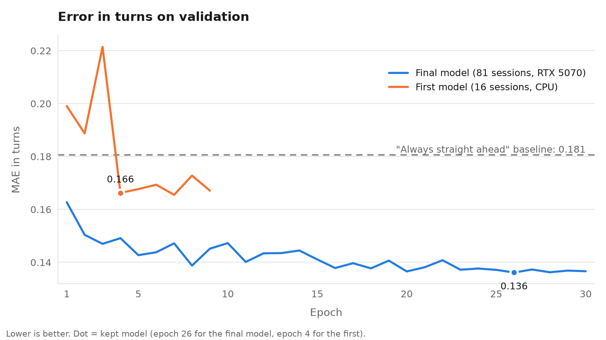
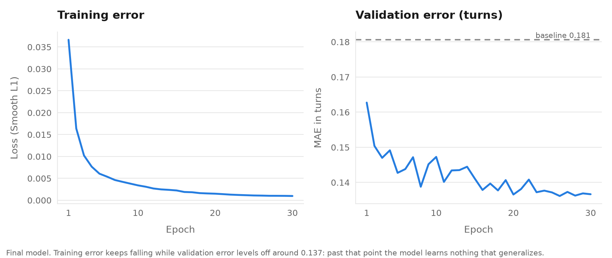

# ETS2 Autopilot

A small deep-learning autopilot for **Euro Truck Simulator 2**. A convolutional neural network looks at the road in a screenshot and predicts the steering angle. A Python script then drives the truck in the game with that prediction.

This started as a school project for a machine-learning course (module CIE 259). The course is over and the project goes on as a personal experiment.

> **Status:** experimental. The model learns something real (it beats the "always drive straight" baseline by about 25 % in turns), but it does not drive cleanly in the game yet. See [Current limitations](#current-limitations).

## How it works

The approach is **behavioral cloning**: the network imitates recorded human driving. It is the same idea as NVIDIA's 2016 paper *End to End Learning for Self-Driving Cars*.

```
 ETS2 screen ──► crop the road ──► PilotNet (CNN) ──► steering ──► virtual controller ──► ETS2
 (1920×1080)      (256×64 RGB)       ~300k params       [-1, 1]      (closed loop on telemetry)
```

1. **Data.** [`ryangowe/ets2-dataset`](https://huggingface.co/datasets/ryangowe/ets2-dataset) on Hugging Face provides screen recordings (1920×1080, 10 FPS, interior camera) synchronized with game telemetry from the SCS SDK plugin. The label is `truck.gameSteer`, the effective steering, roughly in [-1, 1].
2. **Preprocessing** (`prepare.py`). Each frame is cropped to a road band **below the mirrors and above the steering wheel**. The wheel turns with the steering, so leaving it visible would let the model read the answer off the image. The crop is downscaled to 256×64. Frames where the truck is stopped or the game is paused are dropped during training.
3. **Model** (`train.py`). PilotNet (5 convolutional layers, 4 fully connected) with batch normalization, ELU and dropout. Straight road is 75 % of the data, so batches are drawn with weighted sampling to show more turns. Brightness and contrast jitter is applied as augmentation. There is no horizontal flip, because traffic drives on the right. The checkpoint is selected on **validation MAE in turns** (|steer| > 0.05), since the overall MAE is dominated by straight road.
4. **Driving** (`drive.py`, Windows). Captures the screen with `mss`, runs the same crop, predicts, and sends the result through a virtual Xbox 360 controller (`vgamepad` / ViGEmBus). On the test setup, ETS2 interpreted the stick as a steering *speed* rather than an angle. Steering is therefore closed-loop: a proportional controller compares the predicted steering with the real `gameSteer` read from the telemetry shared memory, and moves the stick until they match.

## Results

Trained on 81 sessions (68,390 frames) and validated on 21 other sessions (15,926 frames). 30 epochs take about 15 s each on an RTX 5070 Laptop GPU, versus 2 to 5 min each on a laptop CPU.

| Model | Val MAE (all frames) | Val MAE in turns |
|---|---|---|
| "Always straight" baseline | 0.0307 | 0.181 |
| First model (16 sessions, CPU) | – | 0.166 |
| **Final model** (81 sessions, epoch 26) | **0.0266** | **0.136** |



Training loss keeps decreasing while validation error levels off around 0.137. The model has learned what it can from this data and architecture:



The trained weights are in `models/pilotnet.pt` (1.2 MB) and the per-epoch history is in `models/history.csv`.

## Usage

Requires **Python 3.14** (`prepare.py` uses the stdlib `compression.zstd` module). Install PyTorch separately, as explained in `requirements.txt`.

```bash
python -m venv .venv && source .venv/bin/activate
pip install -r requirements.txt
pip install torch --index-url https://download.pytorch.org/whl/cu130   # or /whl/cpu

# 1. Download some shards (each ~1 GB) into ets2-dataset/
#    https://huggingface.co/datasets/ryangowe/ets2-dataset

# 2. Extract to compressed .npz files (cropped frames + labels)
python prepare.py ets2-dataset/ets2-train-00000{0..3}.tar --split train
python prepare.py ets2-dataset/ets2-val-000000.tar --split val

# 3. Train (auto-selects CUDA, Intel XPU or CPU)
python train.py --epochs 30

# 4. Plot the training curves into figures/
python plot_history.py
```

### Driving in the game (Windows)

1. Install the [SCS telemetry plugin](https://github.com/RenCloud/scs-sdk-plugin) (`scs-telemetry.dll`, revision 12) into `<ETS2>\bin\win_x64\plugins\`.
2. `pip install vgamepad` and accept the ViGEmBus driver installation.
3. In-game settings: interior camera, FOV 71, 16:9 fullscreen on the primary monitor, **lane assist off** (otherwise the game drives instead of the model).
4. Run the scripts **from a terminal on the Windows desktop**. Over SSH, the screen capture comes back black.

```bat
python drive.py --check       :: saves check_full.jpg / check_crop.jpg to verify the crop
python drive.py --pad         :: sweeps the virtual stick so ETS2 can detect and bind it
python drive.py --calibrate   :: measures stick -> wheel response (truck parked)
python drive.py               :: drive: F8 toggles the autopilot, F10 quits
```

Every run writes a CSV log (`drive_YYYYMMDD_HHMMSS.csv`) with the prediction, stick position, in-game steering, speed and loop time.

## Current limitations

- **The labels come partly from the game's own assistant.** The dataset was recorded with ETS2's lane assist on, so the model partly imitates the game AI rather than a human driver.
- **Weak model.** A turn MAE of 0.136 against 0.181 for the baseline is a real but modest gain. The truck still weaves in the game.
- **Indirect control.** The path from virtual controller to Windows to ETS2 bindings adds a dead zone, an offset neutral and speed-based steering, hence the closed-loop workaround.
- **Steering only.** The throttle is left to cruise control and there is no braking.
- **No sense of time.** Each frame is processed on its own.

## Roadmap

- [ ] **Direct input plugin.** Write an SCS SDK *input* plugin (`scs_input_init`) that registers a virtual device whose axes are fed from shared memory. That gives absolute, exact steering with no controller emulation.
- [ ] **Own recordings.** A recorder for screen capture and telemetry, with lane assist off, plus a contribution guide so others can share data.
- [ ] **Pretrained backbone.** Compare ResNet-18 / MobileNetV3 (ImageNet) against the PilotNet baseline.
- [ ] **Multi-view input.** Use ETS2's custom multi-monitor mode (`r_multimon_mode 4`, `multimon` console command, `camera_space_offset`) to render a bumper camera and blind-spot views next to the driver's view, then feed them to a multi-branch network.
- [ ] **Temporal context** (frame stacking or a GRU), then throttle and brake outputs.

## Repository layout

```
prepare.py        dataset shards (.tar) -> data/processed/{train,val}/*.npz
train.py          PilotNet definition + training loop
drive.py          in-game inference, calibration and closed-loop steering (Windows)
plot_history.py   training curves -> figures/
models/           trained weights + training history
figures/          plots used in this README
```

The dataset and extracted data are not included. They are tens of GB, and the dataset has its own license on Hugging Face.

## Contributing

Contributions are very welcome, **especially driving data**. Better data is what this project needs most. The current model learns from a dataset recorded with ETS2's lane assist on. Human driving recorded with lane assist off would make a real difference, as would varied roads, weather, night driving, trucks and camera setups.

Other welcome contributions:

- the SCS SDK input plugin for direct steering (see the [Roadmap](#roadmap));
- model experiments (pretrained backbones, temporal context, multi-view);
- testing `drive.py` on other setups and reporting how it behaves;
- bug reports and fixes.

**A contribution guide is coming soon.** It will cover how to record data in the expected format, which game settings to use, and how to share recordings. Until then, feel free to open an issue to say what you would like to work on, or to share data you already have.

## License

The code is released under the [MIT License](LICENSE). The dataset is not part of this repository and keeps its own license.

## Acknowledgements

- Dataset: [ryangowe/ets2-dataset](https://huggingface.co/datasets/ryangowe/ets2-dataset)
- Telemetry: [RenCloud/scs-sdk-plugin](https://github.com/RenCloud/scs-sdk-plugin)
- Model: Bojarski et al., *End to End Learning for Self-Driving Cars*, NVIDIA, 2016
- Virtual controller: [vgamepad](https://github.com/yannbouteiller/vgamepad) / ViGEmBus
